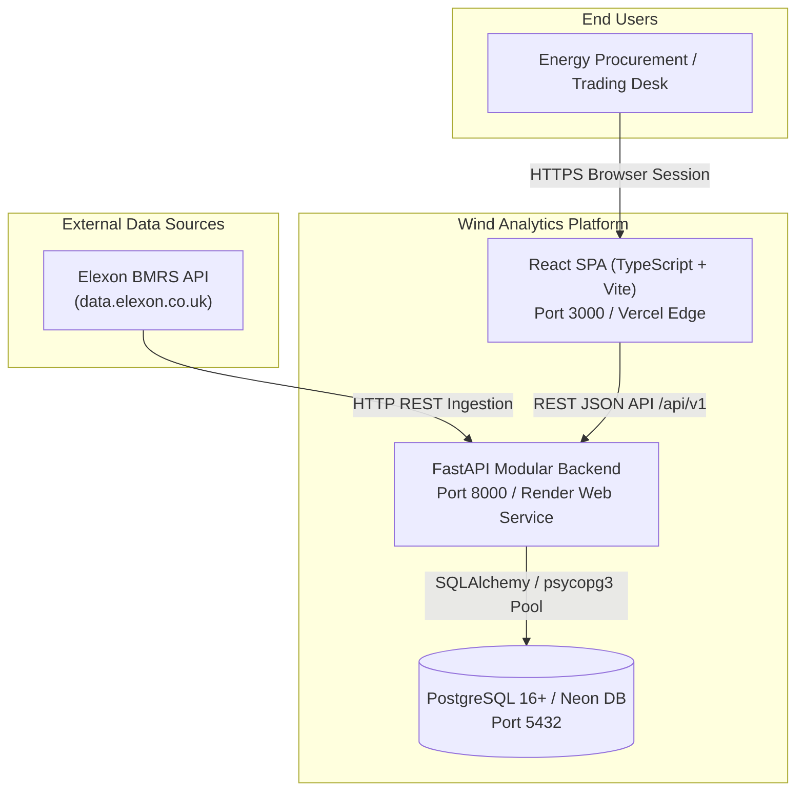
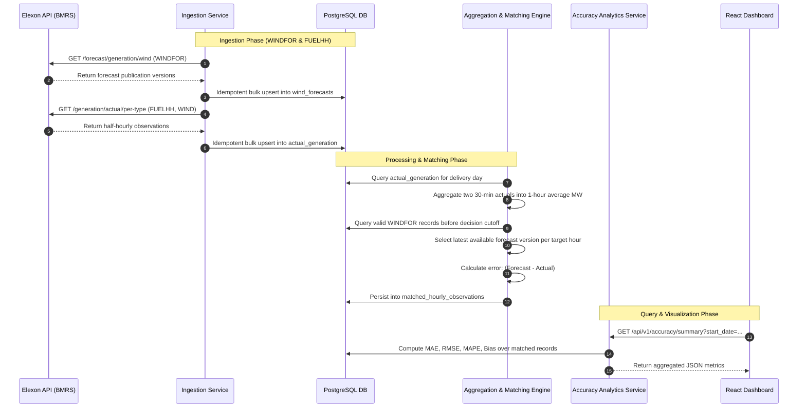
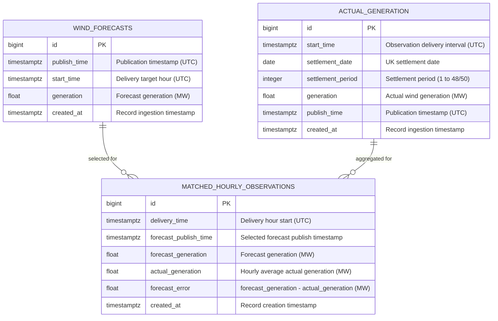
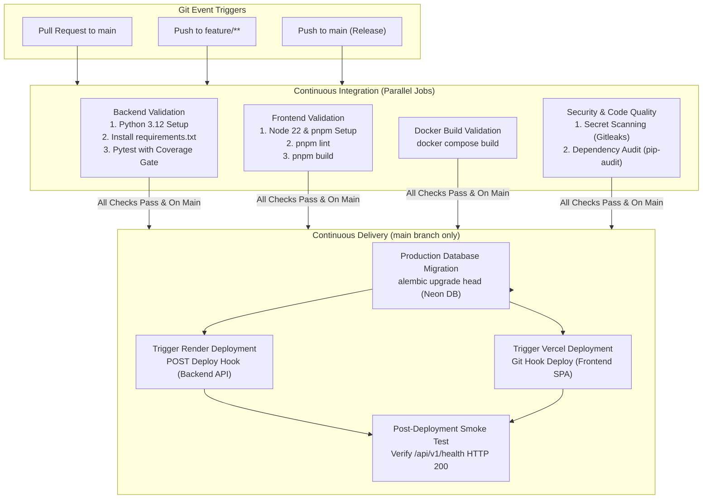

# System Architecture Specification

## UK Wind Generation Forecast Analytics Platform

> [!NOTE]
> All diagrams in this document are provided in dual formats:
> 1. **Universal Unicode Text Diagrams:** Render immediately in any Markdown previewer (including VS Code and offline viewers), plain text editors, and PDF exports.
> 2. **Mermaid Flowcharts:** Render as interactive vector graphics when viewed natively on GitHub.

---

## 1. Architectural Principles & System Context

The application follows a **modular monolithic architecture** designed for high auditability, reproducible calculations, and operational simplicity.

### Core Principles
1. **Separation of Concerns:** Business logic (ingestion, cutoff enforcement, aggregation, accuracy analytics) is strictly decoupled from API delivery (FastAPI routes) and persistence (SQLAlchemy ORM models).
2. **Immutability of Forecast History:** Forecasts are never updated in-place. Every published forecast version is preserved with its `publish_time` to guarantee historical reproducibility.
3. **Prevention of Look-Ahead Bias:** When evaluating trading or purchasing decisions, only forecast publications released prior to the day-ahead decision cutoff are admitted into analysis.
4. **Timezone Determinism:** All timestamps are ingested, stored, and computed in timezone-aware **UTC**. Market-day and settlement period interpretations map to the UK settlement calendar (`Europe/London`).
5. **No Microservices:** All backend services run inside a single cohesive Python process with clear internal domain boundaries.

### System Context Diagram

```text
┌────────────────────────────────────────────────────────────────────────┐
│                   EXTERNAL DATA SOURCE (Elexon BMRS)                   │
│   • WINDFOR: Day-Ahead & Intraday Forecasts (Hourly Generation MW)     │
│   • FUELHH:  Outturn Actual Generation (Half-Hourly Generation MW)     │
└───────────────────────────────────┬────────────────────────────────────┘
                                    │ HTTP REST Pull Ingestion
                                    ▼
┌────────────────────────────────────────────────────────────────────────┐
│                        WIND ANALYTICS PLATFORM                         │
│                                                                        │
│   ┌────────────────────────────────────────────────────────────────┐   │
│   │  Frontend Single Page Application (React 19 + Vite 8)          │   │
│   │  • Local Port: 3000   │  Cloud: Vercel Global Edge CDN         │   │
│   └───────────────────────────────┬────────────────────────────────┘   │
│                                   │ REST API Calls (/api/v1/*)         │
│                                   ▼                                    │
│   ┌────────────────────────────────────────────────────────────────┐   │
│   │  Modular FastAPI Backend Application (Python 3.12)             │   │
│   │  • Local Port: 8000   │  Cloud: Render Web Service             │   │
│   └───────────────────────────────┬────────────────────────────────┘   │
│                                   │ Connection Pool (SQLAlchemy 2.0)   │
│                                   ▼                                    │
│   ┌────────────────────────────────────────────────────────────────┐   │
│   │  PostgreSQL 16+ Relational Storage                             │   │
│   │  • Local: Container (Port 5432) │ Cloud: Neon Serverless DB    │   │
│   └────────────────────────────────────────────────────────────────┘   │
└───────────────────────────────────▲────────────────────────────────────┘
                                    │ Interactive HTTPS Web Session
┌───────────────────────────────────┴────────────────────────────────────┐
│                              END USERS                                 │
│          Energy Procurement, Trading Desk & Analytics Evaluators       │
└────────────────────────────────────────────────────────────────────────┘
```



---

## 2. High-Level Application Architecture

The system is organized into three decoupled logical tiers:

```text
┌────────────────────────────────────────────────────────────────────────┐
│                       CLIENT TIER (Presentation)                       │
│                                                                        │
│   ┌────────────────────────────────────────────────────────────────┐   │
│   │                React 19 SPA (TypeScript + Vite 8)              │   │
│   │                                                                │   │
│   │  ┌──────────────────┐  ┌──────────────────┐  ┌──────────────┐  │   │
│   │  │   OverviewPage   │  │ ForecastExplorer │  │   Accuracy   │  │   │
│   │  └────────┬─────────┘  └────────┬─────────┘  └──────┬───────┘  │   │
│   │           └─────────────────────┼───────────────────┘          │   │
│   │                                 ▼                              │   │
│   │                ApiClient (Fetch / TypeScript Types)            │   │
│   └─────────────────────────────────┬──────────────────────────────┘   │
└─────────────────────────────────────┼──────────────────────────────────┘
                                      │ HTTP / REST (/api/v1/*)
                                      ▼
┌────────────────────────────────────────────────────────────────────────┐
│                         API TIER (FastAPI Backend)                     │
│                                                                        │
│   ┌────────────────────────────────────────────────────────────────┐   │
│   │  REST Routes: /api/v1/accuracy/*  |  /api/v1/health            │   │
│   └────────────────────────────────┬───────────────────────────────┘   │
│                                    ▼                                   │
│   ┌────────────────────────────────────────────────────────────────┐   │
│   │  Pydantic Request & Response Validation Schemas                │   │
│   └────────────────────────────────┬───────────────────────────────┘   │
│                                    ▼                                   │
│   ┌────────────────────────────────────────────────────────────────┐   │
│   │  Core Services: Cutoff Logic, Aggregation Engine, Accuracy     │   │
│   └────────────────────────────────┬───────────────────────────────┘   │
│                                    ▼                                   │
│   ┌────────────────────────────────────────────────────────────────┐   │
│   │  SQLAlchemy 2.0 ORM Engine & Session Connection Pool           │   │
│   └────────────────────────────────┬───────────────────────────────┘   │
└────────────────────────────────────┼───────────────────────────────────┘
                                     │ SQL over TLS (psycopg3 driver)
                                     ▼
┌────────────────────────────────────────────────────────────────────────┐
│                        DATA TIER (PostgreSQL Database)                 │
│                                                                        │
│   ┌─────────────────────┐  ┌──────────────────┐  ┌─────────────────┐   │
│   │   wind_forecasts    │  │ actual_generation│  │ matched_hourly  │   │
│   │ (publish_time, ... )│  │ (settlement_...) │  │ (forecast_error)│   │
│   └─────────────────────┘  └──────────────────┘  └─────────────────┘   │
└────────────────────────────────────────────────────────────────────────┘
```



```mermaid
flowchart LR
    subgraph ClientTier["Client Tier (Presentation)"]
        SPA["Single Page Application (React 19)"]
        Router["Client-Side Router (SPA View Routing)"]
        Views["Views: Overview, Forecast Explorer, Accuracy Analysis"]
        Components["Components: Metric Cards, Recharts Charts, Filter Bars"]
        ApiClient["API Client (Fetch / Typescript Models)"]
        
        SPA --> Router --> Views --> Components --> ApiClient
    end

    subgraph ApiTier["API Tier (FastAPI Backend)"]
        Routes["REST Endpoints (/api/v1/accuracy, /api/v1/health)"]
        Validation["Pydantic Request & Response Schemas"]
        Services["Core Analytical & Ingestion Services"]
        Engine["SQLAlchemy Engine & Session Factory"]

        Routes --> Validation --> Services --> Engine
    end

    subgraph DataTier["Data Tier (PostgreSQL)"]
        Tables["Tables: wind_forecasts, actual_generation, matched_hourly_observations"]
        Constraints["Unique Constraints, B-Tree Indexes"]
    end

    ApiClient -->|HTTP / JSON| Routes
    Engine -->|Connection Pool| Tables
```

### Module Responsibilities

1. **Frontend (`frontend/src/`):**
   - Renders responsive dashboards with Tailwind CSS.
   - Computes no client-side market statistics; visualizes clean server-side aggregates via Recharts.
   - Provides date filters (January 1 – January 31, 2026 decision dates; January 2 – February 1, 2026 delivery dates).

2. **Backend Application (`backend/app/`):**
   - `core/config.py`: Environment variable loading via `pydantic-settings`.
   - `database.py`: Thread-safe database engine and scoped session management.
   - `models/`: Declarative SQLAlchemy models reflecting PostgreSQL schema.
   - `schemas/`: Pydantic validation models for inbound payloads and API responses.
   - `ingestion/`: API chunking, retry handling, and idempotent upserts.
   - `services/`: Time-matching, cutoff enforcement, hourly aggregation, and statistical error metrics (MAE, RMSE, MAPE).
   - `api/v1/`: Versioned API routing and CORS middleware.

---

## 3. Data Ingestion & Processing Pipeline

The core value of the platform lies in its time-series alignment engine that ingests, cleans, matches, and analyzes wind generation data.

```text
[ 1. Ingestion Phase ]
  Elexon API ──► WINDFOR (Forecasts)  ──► Validate ──► Upsert to `wind_forecasts`
  Elexon API ──► FUELHH (Actual Wind) ──► Validate ──► Upsert to `actual_generation`

[ 2. Processing & Alignment Phase ]
  ┌────────────────────────────────────────────────────────────────────────┐
  │ 1. Filter WINDFOR versions published strictly BEFORE decision cutoff   │
  │    (publish_time <= Cutoff(Delivery Date - 1 day, e.g. 17:00 UK))      │
  │ 2. Select latest published version for each delivery hour              │
  │ 3. Aggregate two consecutive half-hourly actuals into 1 hourly average │
  │    Actual_Hourly = (HH1_MW + HH2_MW) / 2                               │
  │ 4. Compute forecast error: Error = Forecast_MW - Actual_Hourly_MW      │
  │ 5. Store aligned records in `matched_hourly_observations`              │
  └────────────────────────────────────────────────────────────────────────┘

[ 3. Analytics & Presentation Phase ]
  React Dashboard ◄── JSON (/api/v1/accuracy/*) ◄── Compute MAE, RMSE, MAPE
```



### Data Pipeline Invariants
- **Actual Generation Aggregation:** Elexon `FUELHH` reports generation in half-hourly settlement intervals (MW). To align with hourly forecasts (`WINDFOR`), consecutive half-hours (e.g. HH1 and HH2) are averaged:
  $$\text{Actual}_{\text{hourly}} = \frac{\text{MW}_{\text{HH1}} + \text{MW}_{\text{HH2}}}{2}$$
  *MW observations are never summed.*
- **Forecast Selection & Cutoff:** For a given delivery date $D$, only forecast publications where $\text{publish\_time} \le \text{Cutoff}(D-1)$ are considered. The latest publication timestamp satisfying this condition is selected.
- **Forecast Error Metric Definition:**
  $$\text{Error} = \text{Forecast} - \text{Actual}$$
  A positive error indicates **overforecasting**; a negative error indicates **underforecasting**.

---

## 4. Database Architecture & Schema

The PostgreSQL database uses version-controlled schema migrations managed by **Alembic**.

```text
┌─────────────────────────────────┐           ┌─────────────────────────────────┐
│         wind_forecasts          │           │        actual_generation        │
├─────────────────────────────────┤           ├─────────────────────────────────┤
│ id           : BIGINT (PK)      │           │ id                : BIGINT (PK) │
│ publish_time : TIMESTAMPTZ (UK1)│           │ start_time        : TIMESTAMPTZ │
│ start_time   : TIMESTAMPTZ (UK1)│           │ settlement_date   : DATE        │
│ generation   : DOUBLE PRECISION │           │ settlement_period : INTEGER     │
│ created_at   : TIMESTAMPTZ      │           │ generation        : DOUBLE PREC │
└────────────────┬────────────────┘           │ publish_time      : TIMESTAMPTZ │
                 │                            │ created_at        : TIMESTAMPTZ │
                 │ 1                          └────────────────┬────────────────┘
                 │ Selected (<= Cutoff)                        │ 2 Half-Hours
                 │                                             │ Averaged
                 ▼                                             ▼
       ┌──────────────────────────────────────────────────────────────┐
       │                 matched_hourly_observations                  │
       ├──────────────────────────────────────────────────────────────┤
       │ id                    : BIGINT (PK)                          │
       │ delivery_time         : TIMESTAMPTZ (UK1)                    │
       │ forecast_publish_time : TIMESTAMPTZ                          │
       │ forecast_generation   : DOUBLE PRECISION (Forecast MW)       │
       │ actual_generation     : DOUBLE PRECISION (Hourly Average MW) │
       │ forecast_error        : DOUBLE PRECISION (Forecast - Actual) │
       │ created_at            : TIMESTAMPTZ                          │
       └──────────────────────────────────────────────────────────────┘
```



### Constraints & Indexes
- **`wind_forecasts`:** Unique constraint on `(publish_time, start_time)` ensures duplicate API responses are handled idempotently via `ON CONFLICT DO NOTHING`.
- **`actual_generation`:** Unique constraint on `(start_time)` ensures each half-hour delivery interval exists exactly once.
- **`matched_hourly_observations`:** Unique index on `(delivery_time)` guarantees exactly one matched observation per delivery hour.

---

## 5. Container & Local Orchestration Architecture

Local development mirrors production through Docker and Docker Compose.

```text
┌────────────────────────────────────────────────────────────────────────┐
│                        DEVELOPER HOST MACHINE                          │
│                                                                        │
│   Browser: localhost:3000   │   API Client: localhost:8000             │
└───────────────┬───────────────────────────────┬────────────────────────┘
                │ Port 3000 -> 80               │ Port 8000 -> 8000
                ▼                               ▼
┌────────────────────────────────────────────────────────────────────────┐
│             DOCKER COMPOSE NETWORK (wind-analytics_default)            │
│                                                                        │
│   ┌────────────────────────────────┐  ┌────────────────────────────┐   │
│   │ frontend (Container)           │  │ backend (Container)        │   │
│   │ • Image: nginx:alpine          │  │ • Image: python:3.12-slim  │   │
│   │ • Serves: Compiled Vite SPA    │  │ • Runs: uvicorn (Port 8000)│   │
│   │ • Fallback: try_files -> index │  │ • Migrations: entrypoint.sh│   │
│   └────────────────────────────────┘  └─────────────┬──────────────┘   │
│                                                     │ Internal 5432    │
│                                                     ▼                  │
│                                       ┌────────────────────────────┐   │
│                                       │ db (Container)             │   │
│                                       │ • Image: postgres:17-alpine│   │
│                                       │ • Healthcheck: pg_isready  │   │
│                                       │ • Volume: postgres_data    │   │
│                                       └─────────────┬──────────────┘   │
│                                                     │                  │
└─────────────────────────────────────────────────────┼──────────────────┘
                                                      │ Host Volume Sync
                                                      ▼
                                       ┌─────────────────────────────┐
                                       │ Volume: postgres_data       │
                                       │ /var/lib/postgresql/data    │
                                       └─────────────────────────────┘
```

```mermaid
flowchart TD
    subgraph Host["Developer Host Workstation"]
        Port3000["Host Port 3000"]
        Port8000["Host Port 8000"]
        Port5432["Host Port 5432"]
    end

    subgraph ComposeNetwork["Docker Bridge Network (wind-analytics_default)"]
        subgraph FE["frontend (Container)"]
            Nginx["Nginx Alpine (Port 80)"]
            Static["Compiled React Assets (/usr/share/nginx/html)"]
            Nginx --> Static
        end

        subgraph BE["backend (Container)"]
            Uvicorn["Uvicorn Server (Port 8000)"]
            FastAPIApp["FastAPI Application"]
            Entrypoint["entrypoint.sh (Alembic Migrations)"]
            Entrypoint --> Uvicorn --> FastAPIApp
        end

        subgraph DBNode["db (Container)"]
            Postgres["PostgreSQL 16/17 Alpine (Port 5432)"]
            PGData[("Volume: postgres_data<br/>/var/lib/postgresql/data")]
            Postgres --> PGData
        end
    end

    Port3000 -->|HTTP| Nginx
    Port8000 -->|HTTP| Uvicorn
    Port5432 -->|TCP| Postgres
    FE -.->|VITE_API_BASE_URL (Client-Side)| Port8000
    FastAPIApp -->|DATABASE_URL| Postgres
```

### Container Specifications
1. **Frontend Container:**
   - **Build Stage:** `node:22-alpine` runs `pnpm build` with `VITE_API_BASE_URL` baked into static production artifacts.
   - **Runtime Stage:** `nginx:alpine` serves static files with an explicit SPA fallback directive (`try_files $uri $uri/ /index.html;`).
2. **Backend Container:**
   - **Base Image:** `python:3.12-slim`.
   - **Security:** Runs as non-root user `appuser`.
   - **Healthcheck:** Standard HTTP poll against `/api/v1/health`.
3. **Database Container:**
   - **Image:** `postgres:17-alpine`.
   - **Healthcheck:** `pg_isready -U postgres -d wind_analytics`.
   - **Persistence:** Named volume `postgres_data` mapped to `/var/lib/postgresql/data`.

---

## 6. CI/CD Pipeline Architecture

Continuous Integration and Continuous Deployment are automated using **GitHub Actions**.

```text
  [ Git Push / PR ]
         │
         ▼
┌────────────────────────────────────────────────────────────────────────┐
│                        STAGE 1: PARALLEL CI GATES                      │
│                                                                        │
│  ┌───────────────────┐  ┌───────────────────┐  ┌────────────────────┐  │
│  │   Backend Tests   │  │  Frontend Build   │  │    Docker Build    │  │
│  │ • Setup Python    │  │ • Setup Node/pnpm │  │ • Validate Compose │  │
│  │ • pytest          │  │ • pnpm lint       │  │ • Build images     │  │
│  │ • --cov threshold │  │ • pnpm build      │  │                    │  │
│  └───────────────────┘  └───────────────────┘  └────────────────────┘  │
└───────────────────────────────────┬────────────────────────────────────┘
                                    │ All Jobs Pass & Branch == 'main'
                                    ▼
┌────────────────────────────────────────────────────────────────────────┐
│                     STAGE 2: DATABASE MIGRATION GATE                   │
│  • Runner connects to Cloud Neon PostgreSQL using secrets.DATABASE_URL │
│  • Executes: alembic upgrade head                                      │
└───────────────────────────────────┬────────────────────────────────────┘
                                    │ Migration Exit Code == 0
                                    ▼
┌────────────────────────────────────────────────────────────────────────┐
│                     STAGE 3: PRODUCTION DEPLOYMENT                     │
│  • Render Deploy: Trigger webhook with commit SHA & verify live status │
│  • Vercel Deploy: Automated git push edge deployment (React SPA)       │
└───────────────────────────────────┬────────────────────────────────────┘
                                    │ Deployment Live
                                    ▼
┌────────────────────────────────────────────────────────────────────────┐
│                     STAGE 4: SMOKE TEST VERIFICATION                   │
│  • Automated curl verification against /api/v1/health (HTTP 200)       │
└────────────────────────────────────────────────────────────────────────┘
```



### Pipeline Safety Controls
- **Concurrency Control:** `concurrency` configuration prevents conflicting concurrent migrations against the live database.
- **Fail-Fast Gates:** Deployments are blocked if backend tests fail, frontend lint fails, or Docker images fail to build.
- **Zero Secrets in Repository:** Production credentials (`DATABASE_URL`, `RENDER_DEPLOY_HOOK_URL`, `RENDER_API_KEY`) are injected at runtime via GitHub Encrypted Secrets.

---

## 7. Cloud Deployment & Production Topology

The production application runs across specialized cloud platforms offering high availability, automatic HTTPS, and isolated scaling.

```text
┌────────────────────────────────────────────────────────────────────────┐
│                              CLIENT BROWSER                            │
└───────────────────┬────────────────────────────────┬───────────────────┘
                    │ 1. HTTPS GET /                 │ 2. HTTPS REST /api/v1/*
                    ▼                                ▼
┌──────────────────────────────────────┐  ┌──────────────────────────────┐
│       VERCEL GLOBAL EDGE NETWORK     │  │   RENDER CLOUD (FastAPI API) │
│ • URL: wind-analytics-bay.vercel.app │  │ • URL: wind-analytics-api... │
│ • Static Production React SPA        │  │ • Python 3.12 Uvicorn Worker │
│ • Automatic SSL / TLS 1.3            │  │ • /api/v1/accuracy/* Routes  │
└──────────────────────────────────────┘  └──────────────┬───────────────┘
                                                         │ 3. TLS SQL
                                                         ▼
                                          ┌──────────────────────────────┐
                                          │  NEON SERVERLESS POSTGRESQL  │
                                          │ • Managed Relational DB      │
                                          │ • Connection Pooling         │
                                          │ • Strict SSL Enforcement     │
                                          └──────────────────────────────┘
```

```mermaid
flowchart TD
    subgraph Users["Clients & Users"]
        Browser["User Web Browser"]
    end

    subgraph Edge["Frontend Layer (Vercel)"]
        VercelCDN["Vercel Global Edge Network<br/>https://wind-analytics-bay.vercel.app"]
        SPAFiles["React Production SPA (HTML, JS, CSS)"]
        VercelCDN --> SPAFiles
    end

    subgraph Compute["Backend Compute Layer (Render)"]
        RenderService["Render Web Service (FastAPI / Uvicorn)<br/>https://wind-analytics-api-d6st.onrender.com"]
        HealthEndpoint["Health Check & DB Ping (/api/v1/health)"]
        AccuracyEndpoints["Analytical REST Endpoints (/api/v1/accuracy/*)"]
        RenderService --> HealthEndpoint
        RenderService --> AccuracyEndpoints
    end

    subgraph Storage["Cloud Data Layer (Neon)"]
        NeonDB[("Neon Serverless PostgreSQL<br/>Managed Storage & Connection Pooling")]
    end

    Browser -->|1. HTTPS GET /| VercelCDN
    Browser -->|2. HTTPS REST /api/v1/*| RenderService
    RenderService -->|3. TLS Encrypted SQL (Port 5432)| NeonDB
```

### Production Security & Network Configuration
- **Transport Security:** All public traffic is forced over TLS 1.3 / HTTPS.
- **CORS Protection:** FastAPI backend permits inbound REST requests exclusively from documented frontend origins (`https://wind-analytics-bay.vercel.app`) and local development URLs.
- **Database Connection Security:** Neon connection strings enforce `sslmode=require` with certificate validation.
- **Health Verification:** `/api/v1/health` actively probes database responsiveness to prevent silent operational disconnects.
